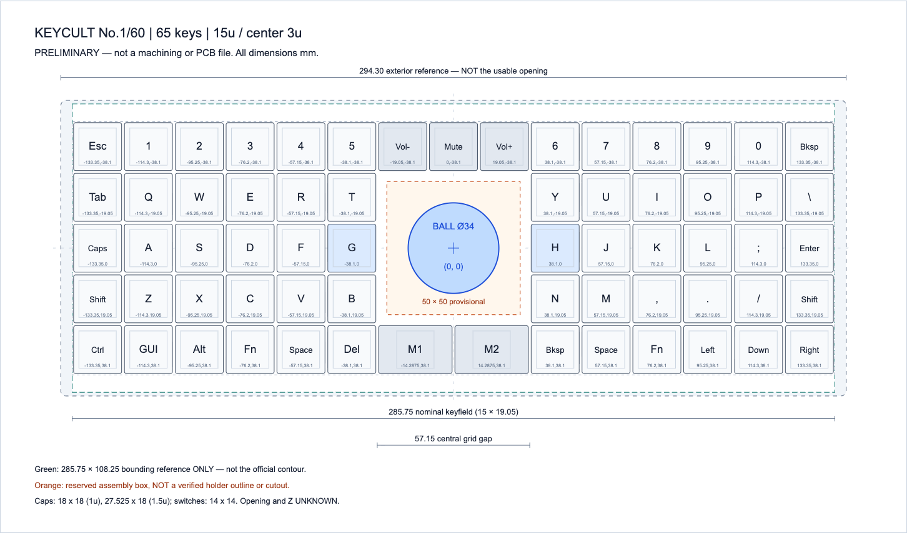
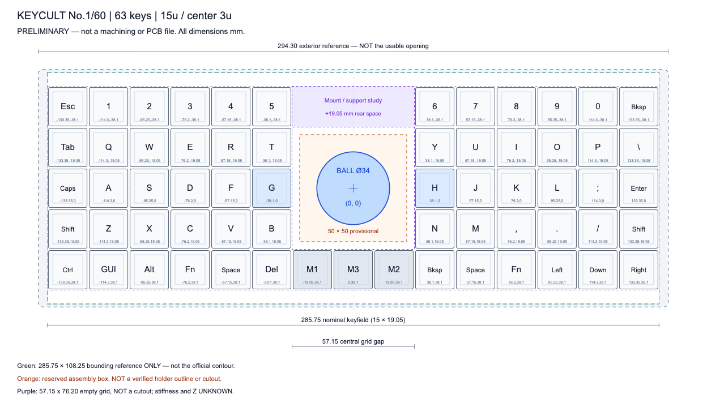

# keycult-ball

Keycult No.1/60에 트랙볼을 결합하기 위한 PCB와 보강판(플레이트)을 제작하는 개인 프로젝트입니다. 기존 케이스를 절삭하거나 새 구멍을 뚫지 않고, PCB와 보강판을 교체해 G/H 사이에 34mm Keyball을 배치하는 것이 목표입니다. 키 배열은 직교 배열을 사용하고, 유선 USB와 QMK 기반 키보드 및 포인팅 장치를 구현할 계획입니다.

현재는 예비 기구 배치와 **65키 및 62키 KiCad 회로도·PCB 배선 초안**을 검토하는 단계입니다. DRAFT E는 외부 조립체 DB1로 UDB C5-JSH를 그대로 사용하며, 하단 1.5u M1/M2 좌표에 맞춰 내부 회로와 매트릭스 배선을 다시 생성합니다. J1 측 USB는 F.Cu 중심 배선과 접지 귀환 경로를 적용합니다. JLC04161H-7628 후보 stackup을 CAD에 명시하고 접지 귀환 경로를 보완했으며, [USB 배선 검토](design/pcb/README.md#usb-routing-findings)에 적용 범위와 한계를 기록합니다. [KiCad 프로젝트 안내](design/pcb/README.md), 배치도, 키 중심 좌표 및 1:1 인쇄 자료가 있으며, 현재 검사 결과는 [65키 보고서](design/pcb/reports/validation.json)와 [62키 보고서](design/pcb/62/reports/validation.json)를 기준으로 합니다. 실제 케이스 조립, 센서 인터페이스, 전원 및 USB 신호 품질과 제조 적합성은 미확정입니다. 제조용 최종 CAD나 빌드·동작 검증된 QMK 펌웨어는 아직 없습니다.

보유 케이스는 NovelKeys 최신 판매 버전의 WK이며, 정확한 리비전과 과거 공개 도면의 호환성은 확인이 필요합니다. G/H 사이 중앙 통합은 필수 조건이며 외부 별도 장치는 범위에서 제외합니다. 34mm Keyball은 현재 예비 배치의 기준이고, 작은 볼과 터치패드도 중앙 통합 후보로 검토합니다. 최종 장치는 아직 선택하지 않았으며 [실현 가능성과 대안 조사](docs/feasibility.md)를 참고합니다.

[로컬 FreeCAD 보강판 초안](design/preliminary/design.md#로컬-freecad-보강판-초안)은 공식 NoLeaf 외곽에 65키·62키 좌표를 적용해 재생성하고 중앙 개구와 네 점으로 고정하는 프레임을 검토합니다. 편집용 FCStd와 STEP/DXF는 원본 사용 조건에 따라 로컬에만 생성합니다. 설명용 볼 높이에서 현재 PCB와 간섭하므로 제조용 도면은 아니며, 홀더·센서의 실제 고정부와 PCB 개구 또는 볼 높이를 추가로 결정해야 합니다. [FreeCAD 실행 및 재현 절차](docs/reproduction.md#freecad-보강판-초안)를 따릅니다.



## 현재 검토 중인 배치

추천안은 15u 너비의 5행 65키 배열이며, 중앙 3열의 가운데 3행을 비워 트랙볼 공간을 확보합니다. 하단 중앙은 1.5u M1/M2 두 키로 총 3u를 차지하며 M3 물리 키는 제거합니다. 실제 키캡과 스위치 조립 적합성은 미확정입니다. 아래 값은 현재 예비 설계의 계산값입니다.

| 항목 | 값 또는 조건 |
| --- | --- |
| 키 피치와 명목 키필드 | 19.05mm, 285.75 × 95.25mm |
| 볼과 G/H 키 중심 | 볼 `(0, 0)`, G `(-38.10, 0)`, H `(+38.10, 0)`, 단위 mm |
| 볼과 키캡 사이 최소 평면 간격 | 지름 34mm 볼과 1u 18 x 18mm, 1.5u 27.525 x 18mm 키캡 가정에서 12.10mm |
| 임시 조립 예약 영역 | 50 × 50mm, 키캡과 최소 4.10mm 간격 |
| 뒤쪽 공간 확보 옵션 | 15u 62키. 상단 중앙 Vol-/Mute/Vol+를 제거해 중앙 명목 빈 영역을 57.15 × 76.20mm로 확장 |
| 보류한 대안 | 14u 너비의 64키 배열. 같은 예약 영역과 키캡이 5.425mm 겹침 |

62키 옵션은 볼 지름 34mm와 중심, G/H 및 하단 1.5u M1/M2를 포함한 나머지 키를 유지합니다. 뒤쪽 한 행을 비워 센서와 배선, 지지 브리지와 체결 간격을 검토할 공간을 확보합니다. 키 제거만으로 강성이 좋아지는 것은 아니며, 빈 영역 전체를 절개하면 강성이 낮아질 수 있습니다. 볼을 키우거나 수직 여유를 늘리는 옵션이 아닙니다.

KiCad 원본은 65키의 `design/pcb/keycult65.*`와 62키의 `design/pcb/62/keycult62.*`로 나눕니다. 두 PCB의 MCU·전원 등 공통 회로는 이전 초안에서 왼쪽으로 76.2mm(4피치) 옮겨 뒤쪽 중앙 빈 영역을 피합니다. 65키 PCB는 중앙 50 x 50mm를 예약하고, 62키 PCB는 명목 빈 영역을 작업 외곽에 맞춰 자른 57.15 x 75.875mm를 부품·구리 금지 영역으로 둡니다. 두 영역 모두 실제 가공 구멍이나 홀더 치수가 아니며, 중앙 Edge.Cuts 개구는 없습니다. 예비 배치와 PCB는 같은 키 좌표를 사용합니다.



50 × 50mm 영역은 실제 홀더 외곽이나 보강판 및 PCB의 가공 구멍 치수가 아닙니다. 공개 도면의 초록색 경계도 공식 보강판 윤곽을 복제한 것이 아니라, 전체 치수만 참조한 285.75 × 108.25mm 직사각형입니다. 현재 검증은 이 경계 안의 포함 여부와 부품 사이 평면 간격을 확인하며, 실제 케이스 개구부 통과나 수직 공간, 조립 가능 여부를 증명하지 않습니다.

## 자료 안내

| 자료 | 내용 |
|---|---|
| [프로젝트 맥락](docs/project-context.md) | 요구사항, 결정 이유, 확정/가정/미확정, 실측·다음 단계 |
| [KiCad 65키·62키 초안](design/pcb/README.md) | 각 배열의 편집 가능한 회로도·PCB, BOM·GPIO 맵, 실제 ERC/DRC·좌표 검증 및 PDF/SVG |
| [PCB 구현 계획](docs/pcb-implementation-plan.md) | 실측 전에 진행할 회로도·PCB 초안, 단계별 산출물과 제조 전 검증 |
| [실현 가능성과 대안 조사](docs/feasibility.md) | 34mm 중앙 통합의 제약과 중앙에 통합할 소형 터치패드·트랙볼 비교 |
| [상세 설계와 출처](design/preliminary/design.md) | 치수 계산, 장착·flex, 센서 방향, QMK·USB 범위 |
| [Ploopy / Keyball / Charybdis 및 라이선스](docs/alternatives-and-licenses.md) | 제품별 차이, 원본 공개 범위와 재사용 조건 |
| [배치 HTML](design/preliminary/layout.html) · [SVG](design/preliminary/layout.svg) · [JSON](design/preliminary/layout.json) | 브라우저 설명도, 편집 가능한 벡터, 모든 키 중심 좌표 |
| [단면 SVG](design/preliminary/section.svg) · [PNG](design/preliminary/section.png) | 수직 설치 센서와 미확정 Z 스택 |
| [1:1 A3 PDF](design/preliminary/print-1to1.pdf) · [SVG](design/preliminary/print-1to1.svg) | 100mm 기준선 포함 종이 검증용 |
| [62키 옵션 SVG](design/preliminary/rear-clearance.svg) · [PNG](design/preliminary/rear-clearance.png) · [1:1 A3 PDF](design/preliminary/rear-clearance-print.pdf) · [인쇄 SVG](design/preliminary/rear-clearance-print.svg) · [인쇄 HTML](design/preliminary/rear-clearance-print.html) | 뒤쪽 공간 확보 비교. 좌표는 `layout.json`의 `rear_clearance` |
| [재현·검증 방법](docs/reproduction.md) | 좌표 생성, PNG/PDF 렌더, 원본 취득·해시 검증 |
| [에이전트 작업 지침](AGENTS.md) | 설계 변경, 검증, 공개 자료 관리, 커밋·푸시 규칙 |

HTML은 저장소를 내려받은 뒤 브라우저에서 엽니다. GitHub에서는 위 PNG로 미리 볼 수 있습니다. 종이 배치는 A3 가로, 배율 100%, 페이지 맞춤을 끈 상태로 출력하고 100mm 기준선을 자로 확인합니다.

## 생성과 검증

Python 3.11 이상과 `uv`를 사용하며, 명령은 저장소 루트에서 실행합니다. 검증 및 렌더 스크립트의 의존성은 각 파일의 메타데이터에 고정되어 있고 `uv run`이 준비합니다.

기존 산출물과 문서의 로컬 링크를 검증하려면 다음 명령을 실행합니다.

```bash
uv run scripts/validate.py
```

배열이나 치수를 변경한 경우에는 산출물을 순서대로 다시 생성하고 검증합니다.

```bash
uv run design/preliminary/build_artifacts.py
uv run scripts/render.py
uv run scripts/validate.py
```

`design/preliminary/build_artifacts.py`의 배열과 치수 상수가 편집 원본이며, 키 중심 JSON과 SVG/HTML은 생성 결과입니다. 설계 변경은 생성기에 반영합니다. 생성기만 실행하면 기존 PNG/PDF는 갱신되지 않으므로 `scripts/render.py`도 실행해야 합니다. 렌더에는 시스템 Chromium이 필요하며, PATH에서 찾을 수 없으면 `KEYCULT_CHROMIUM`에 실행 파일의 절대 경로를 지정합니다.

검증 스크립트는 파일 형식과 로컬 링크, 키 개수와 좌표, 평면 간격, 직사각형 경계 안의 포함 여부, PDF의 A3 크기와 100mm 기준선을 검사합니다. 검증 결과 일부는 `envelope-containment.json`과 `print-validation.json`에 기록됩니다.

공식 윤곽 검사는 별도 절차입니다. 원본 사용 조건을 확인한 뒤 `uv run scripts/fetch_sources.py`로 원본을 취득하고 `uv run scripts/verify_official_contour.py`로 재현합니다. [과거 검사 기록](design/preliminary/plate-containment.json)은 현재 공개 검증으로 갱신되지 않습니다. 추출 좌표와 재검사 출력의 저장 위치, 해시 확인 방법은 [재현 문서](docs/reproduction.md)를 따릅니다.

## 다음 설계 단계

1. [65키·62키 KiCad 초안](design/pcb/README.md)의 실제 ERC/DRC와 미배선 보고서를 검토하고, USB·클록·전원 배선 품질을 보완합니다. GH60의 285.0 x 94.6mm 요약 치수를 작업 외곽으로 사용하며 배열별 중앙 예약 영역에 부품과 구리를 두지 않습니다. USB는 UDB C5-JSH와 적절한 길이의 1:1 케이블을 사용하는 설계 가정으로 진행하고, 조립 전에 커넥터와 케이스 공간 및 케이블 도통을 확인합니다. 센서는 정확한 사양이 확인될 때까지 논리 패드로 남깁니다.
2. QMK 핀맵과 펌웨어 빌드를 병행하고, 실물 부품과 배선 조건이 확인되면 단일 USB 동작을 시험합니다.
3. 후속 실측과 종이 배치 검토를 반영해 중앙 개구, 커넥터와 부품 높이 및 장착 구조를 확정합니다. 볼과 센서는 같은 강체에 고정하고, 기구 시제품 검증 후 최종 배선과 제조 데이터를 완성합니다.

측정할 항목과 결정 이유는 [프로젝트 맥락](docs/project-context.md)에 기록합니다. 예비 SVG를 제조용 도면으로 사용하지 않습니다.

## 범위와 출처 관리

공개 자료는 독립 키 배열, 형상을 복제하지 않는 요약 측정값, 검증 결과, 출처 URL과 해시입니다. 제3자 STEP/DXF/Gerber 원본, 공식 보강판 윤곽 좌표와 이를 복제한 도면은 공개하지 않습니다. 원본 다운로드는 `design/preliminary/sources/upstream/`에, 상세 윤곽과 로컬 검사 결과는 `design/preliminary/sources/local/`에 저장하며 두 디렉토리는 Git에서 제외합니다. 원본 대화, 개인 메모, 인증 정보도 포함하지 않습니다.

저장소 공개 자체가 제3자 자료의 재사용이나 재배포 허가를 뜻하지 않습니다. 자료를 취득하거나 재사용하기 전에 [자료별 라이선스와 배포 범위](docs/alternatives-and-licenses.md), [출처와 측정 기록](design/preliminary/sources/README.md)을 확인합니다.
