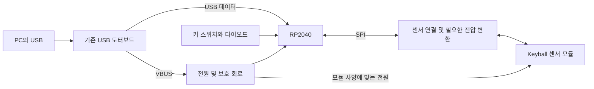

# PCB 구현 계획

작성일: 2026-10-29. 갱신일: 2026-10-30. 상태: UDB 연결 검토를 재개해 저장된 핀 연결과 배선, 확대 도면을 확인했다. 단계 1·2 구현과 66키·63키의 내부 회로, 매트릭스 및 USB J1 배선은 완료했다. 기존 검사에서 두 버전 모두 ERC/DRC 위반, 미연결과 회로도·PCB 연결 불일치가 0건이며, 현재 CAD 해시도 해당 보고서와 일치한다. 이번 환경에는 KiCad가 없어 ERC/DRC를 다시 실행하지 못했다. 센서 커넥터, USB 케이블의 실물 적합성 및 3D 조립 검토는 남아 있다. [KiCad 프로젝트](../design/pcb/README.md)에 실제 회로도·PCB, BOM·핀맵과 검증 결과가 있다. 검사 결과는 [66키 검증 JSON](../design/pcb/reports/validation.json)과 [63키 검증 JSON](../design/pcb/63/reports/validation.json)을 기준으로 한다. 제조 준비 완료나 QMK 빌드·실물 동작 검증을 뜻하지 않는다.

## 재개 지점

- **저장된 설계:** DRAFT C. 66키는 `design/pcb/keycult66.*`, 63키는 `design/pcb/63/keycult63.*`다. 63키는 SW7-SW9와 D7-D9를 제외하며, 하단 키를 위한 COL6-COL8은 유지한다. 각 디렉터리의 `initial-route.ses`에는 수동 QFN 배선과 이번 J1 배선도 포함한다. `.cache/`의 작업 파일 없이 재개할 수 있다.
- **USB에서 확인한 근거:** Wilba WT60-D 공식 판매 문서의 No.1/60 및 UDB 호환 설명과 UDB 원본 회로도를 대조했다. J1은 JST SM04B-SRSS-TB(LF)(SN), 1=VBUS, 2=D-, 3=D+, 4=GND이며 번호 기준 1:1 케이블을 사용한다. 기존 TP1-TP4 번호는 J1 핀 순서와 다르다. [출처 및 고정 리비전](../design/pcb/sources.md#usb-daughterboard-evidence)에 근거와 한계를 기록했다.
- **재개 후 확인한 항목:** 두 버전의 J1 핀 연결과 USB 구리 배선이 동일하며, 저장된 CAD와 검사 보고서의 해시 및 배선 복원용 manifest가 일치한다. J1과 USB 경로 및 접지면을 기존 PDF에서 확대 검토하고 선폭·간격·구리 길이·비아 수를 [PCB 안내](../design/pcb/README.md#usb-daughterboard-interface-and-compatibility-limits)에 기록했다. 검사 회귀 테스트 9개와 저장소 검증은 통과했다. `uv run scripts/validate_pcb.py --keys 66`은 `KiCad 10 kicad-cli is required` 오류로 검사 전에 중단됐다. 같은 도구를 사용하는 63키의 ERC/DRC도 재실행하지 못했으며 기존 보고서를 유지했다.
- **USB에서 아직 확인하지 못한 항목:** 사용자는 2026-10-30 현재 실물 확인 전이라고 확인했다. 보유 도터보드의 리비전과 실제 핀 배열, CC/ESD/과전압 보호 구성, 케이블 길이 및 통로, 삽입·분리 공간과 하부 높이는 미확정이다. J1 원점 `(40.6,112.0)mm`, B.Cu, 90도는 직교 배열에 맞춘 임시 위치를 유지한다. WT60-A 사진에서 정확한 위치를 측정한 값이 아니다. 제조 stackup과 케이블을 기준으로 한 신호 품질 및 층 전환부의 접지 귀환 경로 검토도 남아 있다.
- **센서에서 남은 항목:** 모델·리비전은 사용자가 아직 모른다고 확인했다. TP10-TP17은 MCU 측 3.3V 논리 패드이며, 모듈 커넥터·5V 전원·전압 변환을 확정하지 않았다. 이 패드를 미확인 센서에 바로 연결하지 않는다.
- **검증과 재현:** strict `validate_pcb.py --keys 66` 및 `--keys 63`, 검사 로직 회귀 테스트와 저장소 검증을 사용한다. [재현 절차](reproduction.md#kicad-66키63키-회로pcb-초안)의 생성기는 현재 CAD를 덮어쓰므로 먼저 수동 편집을 보존한다. 회로·배치가 그대로일 때는 `--import-saved`로 수동 배선까지 복원하며, 자동 라우터 재실행을 복원 수단으로 사용하지 않는다.

다음에는 기존 메인 PCB와 도터보드의 양면 표기, 연결 케이블 및 케이스 통로를 확인한다. USB 전원을 분리한 상태에서 핀 연결을 대조한 뒤 J1 위치·방향과 필요한 케이블 길이를 확정한다. 이후 실제 도터보드 보호회로와 USB 경로를 검토하고, KiCad 10 및 해당 Python 바인딩이 있는 환경에서 두 버전의 ERC/DRC를 다시 실행한다. 센서 사양 확인, 중앙 홀더·보강판·높이 실측, QMK 빌드와 실물 동작 시험은 별도 미완료 항목으로 유지한다. 제조 파일 생성이나 발주는 진행하지 않았다.

**케이스 실측을 기다리지 않고 회로도와 PCB 초안을 진행한다.** PCB와 GH60의 호환성은 사용자 확인 완료된 전제로 두고, 공개 GH60 도면을 설계 출발점으로 사용한다. 실측은 중앙 개구, 부품 높이와 커넥터 위치를 확정하고 제조 준비를 완료하는 단계에 반영한다. 전기 연결은 케이스 깊이와 별개로 설계할 수 있지만, 실제 PCB 배치와 배선은 중앙 개구 및 장착 구조의 영향을 받는다.

## 1. 설계 범위와 초안 기준

| 항목 | 초안 기준 | 확정 시점 |
| --- | --- | --- |
| 구조 | 새 메인 PCB 한 장에서 키 매트릭스와 별도 Keyball 센서 모듈을 제어 | 현재 설계 방향 |
| USB | 기존 도터보드용 UDB 규격 JST-SH 4핀 J1을 두고 메인 PCB에는 USB-C 포트를 두지 않음 | 전기 핀 배열 구현 완료. 보유 리비전, 케이블 위치·도달 및 보호회로는 이슈 #3에서 확인 |
| MCU | RP2040을 우선안으로 검토. 메인 PCB에 직접 실장하는 회로를 설계 | 전원, GPIO, 제조 부품 검토 후 회로도에서 확정 |
| 배열 | 15u 직교 66키 기준안과 63키 옵션을 별도 KiCad 프로젝트로 작성 | 이슈 #4 결과로 최종 배열 선택 |
| 키 입력 | 키마다 다이오드 한 개. 5행 x 15열 전기 매트릭스를 우선안으로 검토 | 센서 SPI 핀을 먼저 확보한 뒤 배선과 함께 확정 |
| 스위치 장착 | 첫 초안은 MX 납땜형을 우선안으로 검토 | 핫스왑 요구와 하부 공간을 확인한 뒤 footprint 확정 |
| 센서 | PMW3360 기반 Keyball 센서 모듈과 렌즈를 별도 사용 | 이슈 #2의 정확한 리비전 및 전원/로직 조건 확인 후 인터페이스 확정 |
| PCB 외곽 | GH60 공개 도면을 참고하고 중앙 모듈에 맞게 수정 | 실측과 기구 모형 검증 후 최종 외곽 및 개구 확정 |
| 중앙 공간 | 66키는 50 x 50mm, 63키는 작업 외곽에 맞춰 자른 중앙 57.15 x 75.875mm에 부품과 구리를 두지 않음 | 실제 홀더 외곽과 체결부 확인 후 대체. 예약 영역을 가공 구멍으로 사용하지 않음 |

MCU와 스위치 장착 방식은 초안을 진행하기 위한 우선안이며 구매나 제조가 확정된 상태가 아니다. 현재 배열에는 같은 기능 이름을 가진 키가 있으므로 키 식별에는 label 대신 기존 `r0c0` 형식의 ID를 사용한다. 63키에서는 SW7-SW9와 D7-D9만 제거하고 나머지 reference 번호를 유지한다. COL6-COL8은 하단 SW58-SW60에 필요하므로 유지한다. 스위치를 장착하지 않는 것은 전기적으로 가능하지만 이전 PCB의 상단 중앙 아래에는 공통 회로가 있으므로 기존 PCB를 잘라서는 안 된다. 두 새 초안은 공통 MCU·전원 회로를 왼쪽으로 76.2mm(4피치) 옮겨 이 영역을 피하며, 중앙 Edge.Cuts 개구는 아직 만들지 않는다.

## 2. 전기 구조

RP2040은 QMK에서 SPI를 지원하며 GPIO가 5V 내성이 없으므로, 센서 모듈의 전원 전압과 신호 전압을 구분한다. 5 x 15 매트릭스는 GPIO 20개, 센서의 SCLK/MOSI/MISO/CS는 4개를 사용하는 초안이다. 실제 핀 번호는 RP2040의 SPI 기능 배정과 QMK 설정을 대조해 정하며, 추가 신호가 필요한 모듈이면 GPIO 예산을 다시 계산한다. [QMK RP2040 문서](https://docs.qmk.fm/platformdev_rp2040)

MCU 회로에는 3.3V 전원, 디커플링, 외부 QSPI flash, 클록, USB 연결, 부트 모드 진입과 리셋, SWD 테스트 패드를 포함한다. 부품값과 배치는 [Raspberry Pi 하드웨어 설계 자료](https://datasheets.raspberrypi.com/rp2040/hardware-design-with-rp2040.pdf)의 해당 회로를 대조해 정한다. USB-C CC와 ESD 보호가 도터보드와 메인 PCB 중 어디에 있는지 확인해 누락이나 불필요한 중복을 피한다.

센서 인터페이스는 SCLK/MOSI/MISO/CS, 전원과 GND를 논리 신호로 먼저 정의한다. 정확한 모듈 리비전이 확인되기 전에는 공개 Keyball46 회로의 커넥터 번호를 실제 부품의 확정 핀 번호로 옮기지 않는다. USB 도터보드용 J1은 공개 UDB 사양에 따라 1=VBUS, 2=D-, 3=D+, 4=GND로 배선했다. 보유 도터보드와 기존 케이블이 이 규격을 따르는지, 임시 커넥터 위치까지 도달하는지는 별도 확인한다. 이 미확정 항목은 초안에 표시하고 제조 전에 모두 해소한다.

## 3. 구현 순서와 완료 기준

### 단계 1. KiCad 작업 기준과 입력 자료 준비

- 사용할 KiCad 버전과 기본 라이브러리 버전을 기록하고 `kicad-cli`의 회로 검사 및 PCB 검사 실행 방법을 확인한다.
- 66키는 `design/pcb/keycult66.*`, 63키는 `design/pcb/63/keycult63.*`로 관리한다. `.kicad_pro`, `.kicad_sch`, `.kicad_pcb`, 필요한 프로젝트 전용 라이브러리와 재현 설명을 함께 관리한다. 기존 전역 라이브러리를 수정하지 않는다.
- [GH60 고정 리비전과 참고 파일](../design/preliminary/design.md#pcb-설계-출발점)을 확인한다. 원본 취득 시 출처와 해시를 기록하고 [공개 자료 관리 기준](alternatives-and-licenses.md)을 따른다. 원본 CAD와 형상을 복제한 파일은 기존의 Git 제외 경로에서 취급한다.
- [layout.json](../design/preliminary/layout.json)의 `preferred.keys`와 `rear_clearance.keys`를 각각 66키와 63키의 스위치 위치 입력으로 사용한다. 편집 원본은 계속 `build_artifacts.py`이며, PCB 좌표를 수동으로 따로 유지하지 않는다. 기존 예비 키 좌표는 변경하지 않는다.

완료 기준: 프로젝트가 지정 버전에서 열리고, 좌표 원점과 축 방향, 스위치 기준점 및 사용 라이브러리가 명시되어 있다. 이 단계는 케이스 실측 없이 진행할 수 있다.

### 단계 2. 회로도와 부품 목록(BOM) 초안

- 회로도를 전원/USB, MCU, 키 매트릭스, 센서 인터페이스로 나눠 작성한다.
- 센서 SPI 핀을 우선 배정하고 매트릭스 행과 열, 다이오드 방향, QMK 핀 이름을 대응시킨다.
- 부품 목록에 제조사 부품 번호, 패키지, 전압 정격, 실장 방식과 미확정 여부를 기록한다. 대체품도 footprint와 전기 조건이 맞는지 확인한다.
- 전기 규칙 검사(ERC)를 실행하고 전원 핀, 연결되지 않은 신호, USB 데이터 극성 및 커넥터 방향을 검토한다. 미확정 커넥터는 임시 심벌 또는 명시된 가정으로 남기며 검증 완료로 보고하지 않는다.

완료 기준: 내부 전원, MCU와 키 매트릭스 회로를 검토할 수 있고, 센서 및 도터보드의 남은 인터페이스 질문이 목록으로 남아 있다. 이슈 #2와 #3을 기다리는 항목이 있어도 나머지 회로 작업을 계속한다.

### 단계 3. PCB 배치와 배선 초안

- GH60 외곽을 참고한 작업 외곽에 배열별 66개 또는 63개 스위치를 배치하고, 키 ID와 중심 좌표가 입력 자료와 일치하는지 검사한다. 공개 보강판 참조 경계인 285.75 x 108.25mm를 PCB 외곽으로 사용하지 않는다.
- MCU와 전원 회로는 중앙 예약 영역 바깥 왼쪽에 묶어 배치한다. 63키 예약 영역은 PCB 좌표 x=151.425..208.575mm, y=52.7..128.575mm다. 배열 `(0,0)`은 PCB `(180,100)mm`에 대응하며, 이 영역은 실제 홀더나 가공 구멍 치수가 아니다. 센서는 논리 패드로 남긴다. USB J1은 하단면의 왼쪽 가장자리에 임시 배치하고, 배선 검사와 실제 케이블 적합성을 구분한다.
- 제조사의 지원 공정과 RP2040 배선 조건에 맞춰 층수, 선폭, 간격, 드릴 및 USB 배선 규칙을 정한다. 숫자를 임의로 제조 기준으로 확정하지 않는다.
- MCU 전원, flash와 클록 등 배치가 민감한 회로를 먼저 배선하고 키 매트릭스를 이어서 배선한다. USB 데이터와 센서 SPI의 GND 귀환 경로를 확보한다.
- 중앙을 가로지르는 지름길 배선에 의존하지 않고 상하 연결 구간을 확보한다. 실측으로 개구가 커질 경우 연결 구간과 배선을 다시 검토한다.
- PCB 설계 규칙 검사(DRC), 회로도와 PCB 연결 일치 검사 및 3D 부품 높이 검토를 진행한다. 미배선과 미확정 기구 조건을 구분해 기록한다.

완료 기준: 스위치 위치, 부품 배치, 주요 회로와 매트릭스 배선을 검토 가능한 PCB 초안이 있다. 중앙 절개와 실제 커넥터가 미확정이면 해당 부분의 최종 배선을 보류한다. ERC/DRC 통과만으로 케이스 조립 가능이나 제조 준비 완료를 주장하지 않는다.

### 단계 4. QMK 초안과 개발보드 동작 검증

- QMK 버전 또는 커밋을 고정하고, 회로도와 같은 GPIO/다이오드 방향으로 키 매트릭스 설정을 작성한다.
- 키보드 입력과 포인팅 장치를 같은 MCU에서 처리한다. PMW3360 드라이버를 우선 검토하고, Keyball의 사용자 정의 드라이버를 그대로 가져와야 한다고 가정하지 않는다. [QMK 포인팅 장치 문서](https://docs.qmk.fm/features/pointing_device#pmw-3360-and-pmw-3389-sensor)
- 빌드를 먼저 확인한다. 센서 전원과 신호 조건이 확인되고 시험 부품이 준비되면 작은 키 매트릭스와 개발보드로 이슈 #6의 동작 검증을 진행한다.

완료 기준: 펌웨어가 빌드되고 핀맵이 회로도와 일치한다. 실제 입력, 포인터 이동과 USB 재연결 시험은 이슈 #6에 별도 기록한다. 개발보드와 최종 PCB의 핀 및 USB 연결 차이를 명시한다.

### 단계 5. 실측 반영과 제조 준비

- 이슈 #1과 #2를 반영해 중앙 개구, 장착 홀, 케이블 공간 및 높이 제한을 확정한다. 볼과 센서는 같은 강체에 고정한다.
- 이슈 #3의 부품 및 핀 배열로 커넥터를 확정하고, 이슈 #4에 따라 최종 키 배열과 스위치 footprint를 정한다.
- 변경된 기구 조건에 맞춰 배선과 구리 채움, 보강판 및 PCB 사이 간섭을 다시 확인하고 이슈 #5의 시제품 검증을 진행한다.
- 최종 ERC/DRC에서 미해결 오류와 미배선을 없애고, 경고나 제외 항목은 각각 근거를 기록한다. 키 수와 좌표, BOM과 footprint, 커넥터 핀 번호를 다시 대조한다.
- Gerber와 드릴 파일을 별도 뷰어로 확인하고 필요 시 조립용 BOM과 부품 좌표를 준비한다. 제조 파일을 CAD 리비전 및 검증 결과와 연결한다.

완료 기준: 최종 CAD에 미확정 인터페이스나 기구 치수가 없고, 이슈 #5와 #6의 기구 및 동작 검증이 끝나며, 제조 파일과 BOM이 같은 리비전에 대응한다. 제조 데이터 준비와 실제 주문은 구분하며 이 계획은 구매나 발주 실행을 뜻하지 않는다.

## 4. 실물 확인 이슈와 작업 의존성

| 이슈 | 확정할 항목 | 기다리지 않고 진행할 작업 |
| --- | --- | --- |
| [#1 케이스 내부 공간](https://github.com/gytkk/keycult-ball/issues/1) | 중앙 높이, 내부 돌출물, 케이스 개구부 | 회로도, MCU 핀 배정, 스위치 배치 |
| [#2 볼/홀더/센서 세트](https://github.com/gytkk/keycult-ball/issues/2) | 모듈 외곽과 리비전, 센서 인터페이스 검토의 입력 | MCU와 키 매트릭스 회로, 논리 신호 정의 |
| [#3 USB 도터보드](https://github.com/gytkk/keycult-ball/issues/3) | 커넥터 부품, 핀 배열, 케이블 통로 | USB 논리 회로와 MCU 주변 회로 |
| [#4 종이 배치 사용성](https://github.com/gytkk/keycult-ball/issues/4) | 66/63키 선택, 실제 키캡 조건 | 66키·63키 초안과 공통 회로 |
| [#5 기구 시제품](https://github.com/gytkk/keycult-ball/issues/5) | 실물 간섭, 휨, 조립 및 정비 경로 | 회로 검증, 펌웨어 구현 |
| [#6 단일 USB 동작](https://github.com/gytkk/keycult-ball/issues/6) | 실제 키/포인터 입력, 도터보드 연결 동작 | CAD 작성과 정적 검사 |

첫 구현 목표는 단계 1부터 3까지의 검토 가능한 회로도와 PCB 초안이다. 실측을 기다리는 동안 단계 4의 펌웨어 빌드까지 병행할 수 있다. 실제 제조 준비 완료는 단계 5의 조건으로 판단한다. PCB를 작성할 때 기존 예비 배치 검증도 유지하며, 실측으로 배열이나 치수를 변경하면 생성기와 관련 검증 및 기준 문서를 함께 갱신한다.
